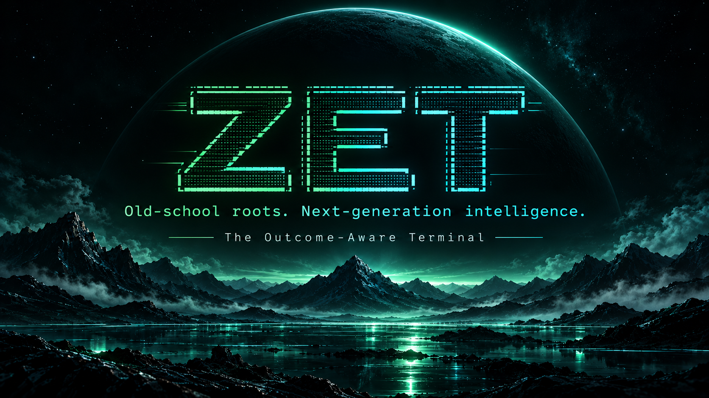

<div align="center">



<sub>Owner-selected primary brand artwork. Concept illustration, not a screenshot of shipped ZET UI.</sub>

# ZET

### Old-school roots. Next-generation intelligence.

**The Outcome-Aware Terminal**

*A native Linux-first terminal connecting commands, development work, and verifiable outcomes.*

</div>

**ZET** is the product name. **“Old-school roots. Next-generation intelligence.”** is the owner-selected brand slogan. **“The Outcome-Aware Terminal”** is the proposed product descriptor, pending naming/trademark clearance; neither phrase is asserted to be exclusive.

The signature ZET ASCII wordmark is a planned part of the P2-B native flagship identity. Its precise artwork remains subject to owner visual approval; decorative art must never impersonate shell output or delay access to the real terminal.

ZET is a genuine **Rust + wgpu desktop terminal** with an ambitious new layer: **Mission Control**. The goal is to connect real commands, errors, files, changes, human decisions, agent activity, checkpoints, and verification into an inspectable development workstream.

## Our defining experience

A failed test is more than red text: ZET should let you follow its original command and output, related files, the subsequent investigation, the exact approved changes, and the evidence that a fix actually worked. Any association must have known provenance; ZET must never invent relationships or falsely report verification.

- **The real terminal remains central.** Native local PTY, shell, scrollback, editors, and conventional terminal programs must work without AI. SSH integration is a future compatibility goal, not a shipped ZET transport.
- **Mission Control makes the work navigable.** Missions group objectives, commands, real sessions, decisions and outcomes—not just tabs or agent processes.
- **An optional agent-aware layer.** Existing coding CLIs can run unchanged. ZET must not become another Hermes/OpenClaw or require its own autonomous agent to be useful.
- **Evidence over claims.** Proposed, executed, and verified are distinct statuses; approvals, diffs, checkpoints, and undo reflect the actual underlying systems.
- **A beautiful native interface.** Futuristic dark design, collapsible mission rail and contextual inspector, central living workstream; one-click/key focus layout.
- **Terminal-grade performance and trust.** GPU acceleration, demand-driven frames, strong compatibility, local-first operation, keyboard accessibility and policy gates.

## What ZET is not

No Electron, Chromium shell, webview UI, or browser required for operation. No forced AI login. No generic agent orchestration dashboard. No synthetic metrics represented as live telemetry.

## Current status

**In development; not a production release.** ZET already has a native Rust/wgpu Linux terminal, real PTY, tabs, shell integration, scrollback, observed command recording, a native collapsible Mission Rail with P2-B1 visual polish ([PR #35](https://github.com/kryptek2000/zet/pull/35)), a first native Contextual Inspector foundation ([PR #43](https://github.com/kryptek2000/zet/pull/43)), additive startup instrumentation, and Wayland clipboard paste support ([PR #30](https://github.com/kryptek2000/zet/pull/30), merged).

**Still planned:** Inspector recorded-command history and detail, mission/evidence graph, exact-commit CI verification receipts, ZET-managed SSH transport, broader agent-aware workstreams, and full visual harmonization. The [approved visual reference](docs/design/ZET-FLAGSHIP-UI-REFERENCE.md) and [P2-B branding plan](docs/design/P2B-ZET-ASCII-IDENTITY.md) remain design targets; shipped UI must be represented by genuine native captures. See [Current State](docs/CURRENT-STATE.md) for the verified implementation and release status.

## Build and verify

```bash
cargo fmt --all -- --check
cargo check --workspace --all-targets
cargo clippy --workspace --all-targets -- -D warnings
cargo test --workspace
```

## The definitive plan

- [Product Charter / Approved Direction](docs/ZET-PRODUCT-CHARTER.md) — authority, UX, boundaries and naming
- [Execution Roadmap](docs/ROADMAP.md) — ordered milestones and acceptance criteria
- [Architecture and performance baseline](docs/ZET-DESIGN.md) — original system design, retained for implementation constraints; superseded where positioning conflicts with charter
- [Engineering rules](AGENTS.md) — authoritative security/performance/testing gates
- [Native Mission Control architecture](docs/design/A5-mission-control-architecture.md) — native layout, render and PTY constraints
- [UI component design reference](docs/design/A4-ui-component-spec.md) — historical design proposal, to reconcile before implementation
- [Flagship UI reference](docs/design/ZET-FLAGSHIP-UI-REFERENCE.md) — original approved visual north star
- [P2-B ASCII wordmark planning](docs/design/P2B-ZET-ASCII-IDENTITY.md) — approved design requirements; artwork implementation remains planned
- [Shortcuts](docs/SHORTCUTS.md) — existing behavior (do not break it to implement mockup shortcuts)

**Decision hierarchy:** product vision and scope: Product Charter → Roadmap. Implementation: code, engineering rules, technical specs. Security, performance and compatibility protections cannot be relaxed by marketing copy.
